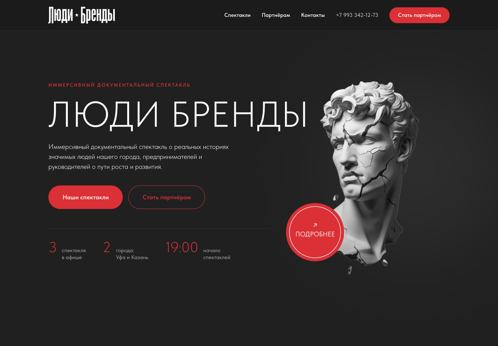
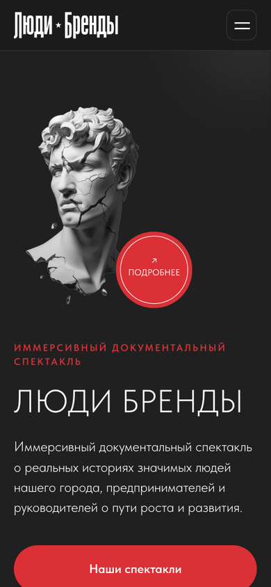

# stage-brand-sites

Custom websites for performers, artists, and stage productions.

## Люди Бренды — static site

Static replacement for the Tilda site `lyudi-brendy.ru`. Fully self-hosted: no request goes to
`tildacdn.com` at runtime.

**Live demo:** https://ofrys-tech.github.io/stage-brand-sites/
(GitHub Pages, built from `main` — every push updates it.)

[](https://ofrys-tech.github.io/stage-brand-sites/)

<p align="center">
  
</p>

| route | content | source |
|---|---|---|
| `/` | new hub page (hand-built) | this repo |
| `/ufa-2026/` | Спектакль в Уфе 2026 | Tilda page `118761336` (was `/`) |
| `/kazan/` | Спектакль в Казани 2025 | Tilda page `57448733` |
| `/ufa/` | Спектакль в Уфе 2024 | Tilda page `63388755` |
| `/partner/` | Стать партнёром | Tilda page `60132875` |

Run it:

```bash
python3 -m http.server 8777        # then open http://127.0.0.1:8777/
```

No build step, no dependencies. Deploy = serve this directory (the repo root) as the web root.
All internal links are relative (`kazan/`, `../assets/…`), so the same files work under the GitHub
Pages sub-path and at the root of `lyudi-brendy.ru`. Pages must be served as directory indexes
(`kazan/index.html`).

### How the spectacle pages were ported

`tools/port_tilda.py` turns the verbatim snapshots in `docs/captures/…/published-html/` into
`<route>/index.html`. The captured HTML already carries the complete generated Zero Block CSS
inline, so the port is byte-faithful and only rewrites references:

- CDN libraries → `assets/tilda/` (Tilda runtime, self-hosted)
- CDN images → `assets/img/tilda/<hash>/<name>` (originals, 160 files)
- `fonts-tildasans.css` → `assets/tilda/fonts.css` (TildaSans variable, local)
- links `https://lyudi-brendy.ru/…` → relative routes
- telemetry (`tilda-stat`, `neo` fallback) and the dead `/script.js` reference are dropped
- native `loading="lazy"` below the first screen; popup images stay eager
- the two 3600×420 stadium outlines in the hero (the arcs sticking out of the viewport) lose their
  1px border — the faint panel fill stays
- **navigation** (`assets/tilda/site-<route>.css`, generated per page): spectacle-to-spectacle links
  are gone ("Спектакль в Казани 2025", "Уфа 2024", "Уфа 2026" — 2 header items and 2 hero buttons per
  page); a red "← На главную" pill sits left of "О спектакле" (the nav buttons are shifted right by
  170px to make room), styled like the "Смотреть фото" button; the in-page anchors are repaired
  ("О спектакле" / "Партнеры" / "Актеры" and the roundel scroll smoothly to the right section —
  Tilda had copied the Kazan record ids into the other pages, so they did nothing, and on the old root
  page the roundel opened a photo popup instead of scrolling); the bottom plaque is removed entirely
  from the three spectacle pages — the date pill, the time pill, the "Смотреть фото" button and the
  empty card that framed them

```bash
python3 tools/port_tilda.py plan     # asset manifests (tools/_images.txt, tools/_libs.txt)
python3 tools/port_tilda.py build    # rewrite the four pages
```

**Fidelity check** (how the port was verified): every `.tn-elem` on each page was measured in
Chromium on both the live Tilda page and the local copy after a full-page scroll:

| page | elements | missing | max delta | font mismatches |
|---|---|---|---|---|
| `/ufa-2026/` | 209 | 0 | **0 px** | 0 |
| `/kazan/` | 145 | 0 | **0 px** | 0 |
| `/ufa/` | 186 | 0 | **0 px** | 0 |
| `/partner/` | 46 | 0 | **0 px** | 0 |

Also verified: 0 console errors, 0 failed requests, 0 unloaded images, no horizontal overflow at
320–1440 px, mobile Tilda burger menu works.

### Weight

| route | HTML | images | libraries | first screen | whole page |
|---|---|---|---|---|---|
| `/ufa-2026/` | 704 KB | 27.4 MB (75) | 519 KB | ~1.5 MB | 28.6 MB |
| `/kazan/` | 489 KB | 4.7 MB (58) | 738 KB | ~2.6 MB | 5.9 MB |
| `/ufa/` | 537 KB | 4.2 MB (65) | 489 KB | ~1.3 MB | 5.2 MB |
| `/partner/` | 167 KB | 1.6 MB (21) | 706 KB | ~1.3 MB | 2.4 MB |

The originals are kept because they are the source of truth; Tilda used to serve WebP/resized
variants, so an image pipeline is the obvious next optimisation (the `/ufa-2026/` page carries most
of the weight: 7 files are ≥ 1 MB, `Mask_group.png` alone is 2.8 MB).

### Structure

```
index.html                     hub page
ufa-2026/ kazan/ ufa/ partner/ ported spectacle pages (Tilda markup, local assets)
assets/css/main.css            hub styles + design tokens
assets/js/main.js              hub interactions (menu, reveal, year)
assets/fonts/TildaSans-VF.woff2
assets/img/                    hub brand assets + og.png
assets/img/tilda/<hash>/       images of the ported pages (160)
assets/tilda/                  Tilda runtime used by the ported pages + fonts.css
tools/port_tilda.py            the port script; tools/_images.txt / _libs.txt are its manifests
docs/tilda.md                  Tilda account/API/migration reconnaissance
docs/captures/                 verbatim snapshots of the Tilda project (11092055), sanitized
docs/preview*.png              README screenshots
.nojekyll                      keep GitHub Pages from running Jekyll
```

### Hub design tokens (measured from the live Tilda site)

| token | value |
|---|---|
| background | `#202020`, deep `#0a0a0a`, header `#1a1a1a`, card `#171717` |
| hairlines | `#373737`, `#323232` |
| text | `#ffffff`; muted `#acacac`, `#a6a6a6`, `#949494` |
| accent | `#da3036` (soft `#ec777b`) |
| radius | pills 30–50px, cards 20px |
| type | TildaSans; display 42px/300 uppercase in accent, body 20px/300, labels 20px/400 muted, values 20px/700 accent, buttons 18px/600 |
| container | 1200px (1160px content) |
| motion | 0.2s ease-in-out, matching Tilda's `--t396-speedhover` |

Contacts (from `lyudi-brendy.ru`): `+7 993 342-12-73`, `Dir-ufa@mail.ru`,
ИП Злобина Инна Сергеевна, индекс 450091, г. Уфа, Карла Маркса, 58.

### Known leftovers

- **Form backend.** The T702 popup form on `/kazan/` and `/partner/` still posts to Tilda's own
  handler (`data-tilda-formskey`, `action=""`). It needs a real backend before the Tilda account is
  retired.
- **No `<h1>`.** Tilda renders every heading as an absolutely positioned `div`, so the ported pages
  ship without an `<h1>`. Worth fixing while adding the remaining defects.
- **`/13mart`, `/30mart`** ad stubs are not ported; links to them still point at the live domain.
  They should become real redirects to `/`.
- **Empty T456 header.** On these pages the Tilda header block is a 0×0 placeholder — every visible
  nav item lives in the hero Zero Block. That is why the back pill is placed in the hero rather than
  in the header markup.
- **Images.** 27 MB of originals on `/ufa-2026/`; no WebP/responsive pipeline yet.
- **TildaSans** is vendored from Tilda's CDN. Confirm the licence before publishing.
